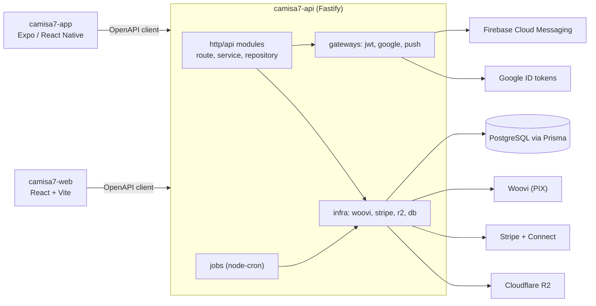
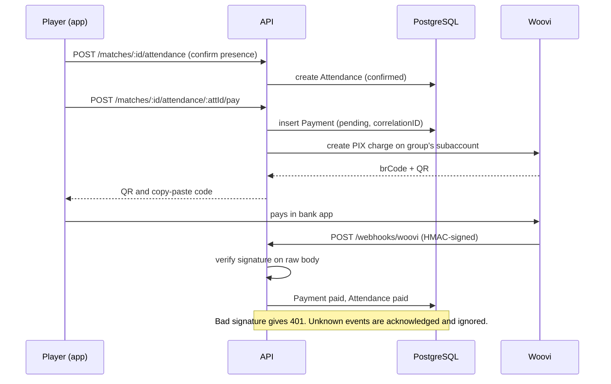
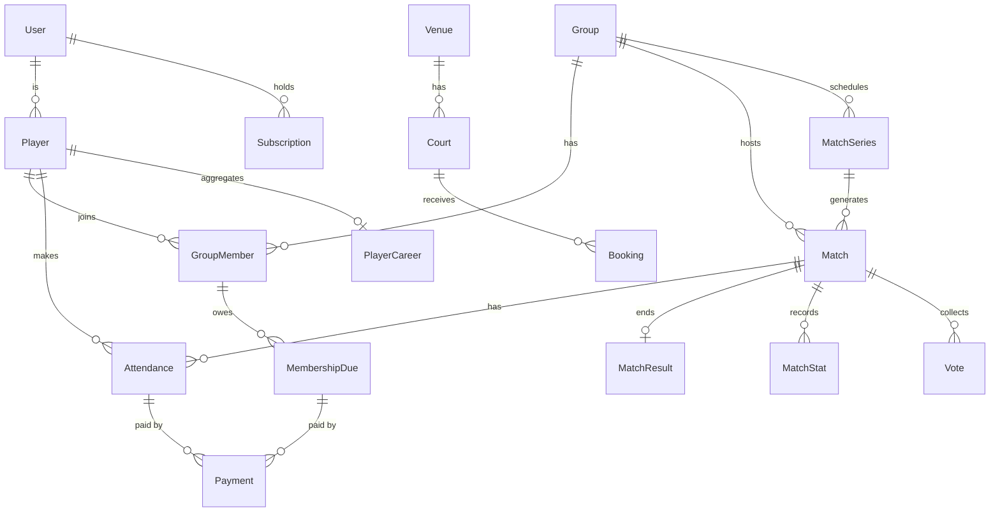

# Camisa7 API

Backend for Camisa7, a football (pickup match) organizer: groups, matches, attendance, PIX payments, ratings, rankings and court bookings.

**Status:** Prototype source, available for portfolio review. Not asserted to be in production; no usage or performance claims are made.

## What it does

- Auth with own JWT (access + refresh, argon2) and Google Sign-In (`src/http/api/auth`, `src/gateways/`).
- Groups, members and roles, invites with public links, join requests (`src/http/api/groups`, `invites`).
- Matches and recurring series with attendance, team assignment, results, stats and votes (`src/http/api/matches`, `series`).
- Player career, reputation tags and rankings computed when a match is finalized (`matches/children/reputation`, `rankings`).
- PIX payments per attendance and monthly membership dues through Woovi, confirmed by signed webhook (`payments`, `dues`).
- Subscription billing and entitlements via Stripe; venue/court booking with Stripe Connect fees (`billing`, `bookings`, `connect`).
- Cron jobs: recurrence horizon, membership dues, booking expiry, auto-finalize after the 48h voting window (`src/jobs`).
- Shareable public pages and OG images (`src/http/api/share`).

## Architecture



Module layout: `src/app.ts` builds the Fastify instance (helmet, CORS, error handler, gateways, Swagger, raw-body opt-in, routes); `src/server.ts` starts it and schedules the jobs. Each feature folder under `src/http/api/<feature>/` holds a controller, service, repository, Zod schema and tests, so business logic is testable without HTTP.

Boundaries:

- Zod schemas are the single source of truth: they validate requests, serialize responses and generate `openapi.json`, from which both clients generate typed hooks (Kubb).
- Third-party providers (Woovi, Stripe, R2, FCM) are config-gated: unset keys disable the feature (HTTP 503 or no-op) instead of breaking boot.
- Repositories are injected into services, so webhooks and jobs reuse the same code as routes.
- Time is injected into jobs (`now` parameter), so time-window rules are tested without waiting.

### Core flow: confirm attendance and pay by PIX



Files: `src/http/api/matches/children/attendance/pay/pay-attendance.service.ts`, `src/http/api/payments/webhook/woovi-webhook.service.ts`, `src/infra/woovi/webhook.ts`.

### Data model (Prisma, `prisma/schema.prisma`)



## Key engineering decisions

- Feature-sliced modules with a controller/service/repository split: `src/http/api/*`.
- Signature verification on the raw body for Stripe and Woovi webhooks, opt-in per route: `src/app.ts`, `src/infra/woovi/webhook.ts`.
- Idempotent PIX charges (reuse the pending `Payment`, roll back the row if the provider call fails): `pay-attendance.service.ts`.
- Entitlements as a service over Stripe subscriptions, with a reviewer allowlist that hides in-app payments: `src/http/api/billing/entitlements.service.ts`.
- Jobs take an injected clock and delegate to the same core used by HTTP endpoints: `src/jobs/finalize-matches.job.ts`.
- Three test tiers (unit, integration, e2e) as separate Vitest projects: `vitest.config.ts`.

## Tech stack

Node 22, TypeScript, Fastify 5, Zod (type provider), Prisma 7 with PostgreSQL, jose + argon2, Stripe, Woovi, Cloudflare R2 (S3 SDK), firebase-admin, node-cron, Vitest, Biome, tsup.

## Getting started

Prerequisites: Node >= 22, pnpm 10, a PostgreSQL database.

```bash
pnpm install --frozen-lockfile
cp .env.example .env     # fill placeholders locally
pnpm db:generate
pnpm db:migrate
pnpm dev
```

Environment variables (see `.env.example` for the full list and comments):

| Name | Purpose |
|---|---|
| `DATABASE_URL` | PostgreSQL connection |
| `JWT_ACCESS_SECRET`, `JWT_REFRESH_SECRET` | Token signing |
| `GOOGLE_CLIENT_IDS` | Accepted Google Sign-In clients |
| `GOOGLE_APPLICATION_CREDENTIALS` | Push (optional) |
| `R2_*` | Object storage for uploads (optional) |
| `STRIPE_*` | Billing and Connect (optional) |
| `WOOVI_*` | PIX charges and webhook HMAC (optional) |
| `PLATFORM_FEE_BPS`, `PLATFORM_FEE_MIN_CENTS` | Marketplace fee |

Swagger UI is served by `src/http/plugins/swagger`; `openapi.json` is committed for client generation.

## Testing

64 test files under `src/` and `test/` (386 tests in the unit project, passing locally); additional integration and e2e projects need a database.

```bash
pnpm typecheck && pnpm check && pnpm test:unit && pnpm build
pnpm test:integration   # needs a database
pnpm test:e2e
```

## Project structure

```text
src/app.ts, server.ts   app composition, startup and cron
src/http/api/<feature>  controller, service, repository, schema, tests
src/gateways            jwt, google, push
src/infra               db, woovi, stripe, r2, logger
src/jobs                scheduled jobs
prisma/                 schema and migrations
test/                   integration and e2e suites
```

## Related repositories

- [camisa7-app](https://github.com/mkwitko/camisa7-app): Expo mobile client
- [camisa7-web](https://github.com/mkwitko/camisa7-web): public invite and player profile pages

## License

All rights reserved. Source available for portfolio review.
